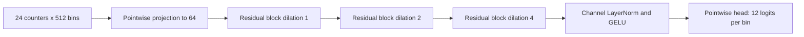
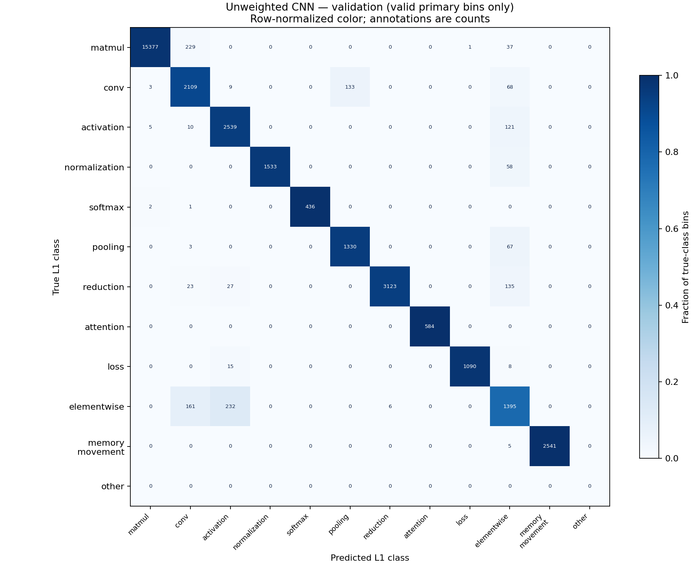
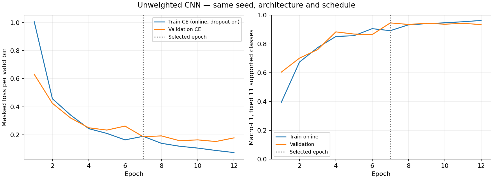
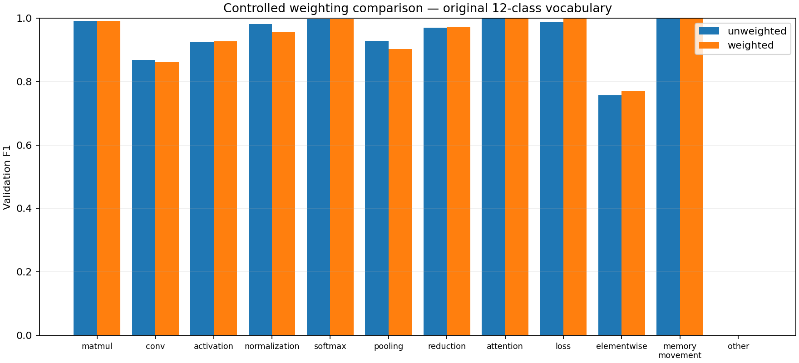
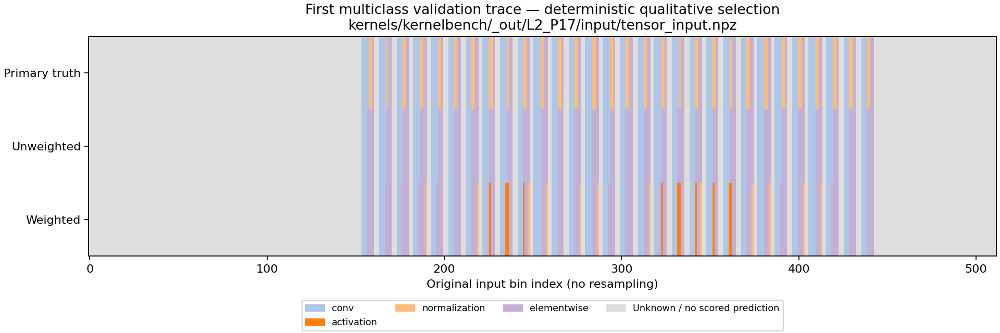

# CNN baseline: primary GPU operation recognition

> **VERIFIED WITH QUALIFICATIONS** · Official validation · Frozen unweighted model

## Overview

This counter-only baseline asks whether local hardware activity identifies annotated
primary L1 GPU operations. It provides a reference for the TimeNet hackathon
research project; it does not establish the capabilities of OpenTSLM.

## Dataset and supervision

KernelSight v4 supplies 1,124 training and 160 validation traces, each with 24
counter channels and 512 bins. Training has 233,821 valid primary L1 bins;
validation has 33,416. Unknown -1 labels are masked, never idle/background.
The classifier retains 12 outputs, with 11 training-supported classes.
The official test partition remains reserved and unevaluated.

## Architecture

The [actual implementation](../src/kernel_xray/phase3/cnn.py) has 126,540 parameters,
width 64, dropout 0.1, per-time channel LayerNorm, GELU, and same-length residual
convolutions. Each block has two kernel-5 convolutions. Its receptive field is
57 bins; original time order is preserved.



## Experimental protocol

[Configuration](../configs/phase3_cnn.json) and
[training implementation](../src/kernel_xray/phase3/cnn_training.py) define AdamW,
seed 7, masked cross-entropy, and earliest strict-best validation macro-F1 over
the fixed 11 training-supported classes. Patience is five epochs.
Population z-scores use all official training bins only; validation uses the
unchanged saved statistics. Only counters enter the model.
Weighted loss caps square-root inverse-frequency ratios at four, rescales their
training-bin expectation to one, and divides the summed loss by valid-bin count.
Zero-support `other` remains a softmax output without fabricated positives.

## Main results

Official-validation results on **annotated primary L1 bins**, not the test set:

| Experiment | Macro-F1 | Accuracy | Best epoch |
|---|---:|---:|---:|
| Unweighted | 0.945925 | 95.93% | 7 |
| Weighted | 0.943411 | 95.88% | 13 |

Macro-F1 uses the fixed 11 training-supported classes. All-12 macro-F1 is
0.867098 unweighted and 0.864794 weighted, including zero F1 for unsupported `other`.
The paired trace-bootstrap difference interval includes zero; weighting has no
established advantage.

| Class | Validation bins | Unweighted F1 |
|---|---:|---:|
| matmul | 15644 | 0.991073 |
| conv | 2322 | 0.868259 |
| activation | 2675 | 0.923777 |
| normalization | 1591 | 0.981434 |
| softmax | 439 | 0.996571 |
| pooling | 1400 | 0.929095 |
| reduction | 3308 | 0.970328 |
| attention | 584 | 1.000000 |
| loss | 1113 | 0.989111 |
| elementwise | 1794 | 0.756508 |
| memory_movement | 2546 | 0.999017 |
| other | 0 | 0.000000 |

Both conditions are available in [per-class CSV](../results/cnn/per_class.csv)
and [comparison JSON](../results/cnn/comparison.json).

## Verified visualizations

These files are byte-for-byte copies of historical result plots, not new experiments.
Their original paths and SHA256 hashes are in [provenance](../results/cnn/provenance.json).









## Independent verification

The [full independent audit](phase3_cnn_independent_audit.md) confirms every saved
validation prediction through CPU replay, independently reconstructs integer
confusion matrices, checks checkpoint/source integrity, and verifies physically
separate train/validation TimeF views. Regression: **61 passed, one CUDA skip**.
The [compact verdict](../results/cnn/audit_verdict.json) records the qualifications.
No test arrays were decoded during the CNN audit.

## Limitations

- Validation primary-label coverage is only **40.79%**.
- All validation traces share collector families with training. Exact counter
  duplicates were absent, but 47 validation traces had similar training signatures.
  Similarity does not establish leakage; unseen-workload generalization is preliminary.
- Boundary accuracy is **63.92%**, interior **99.98%**, and multiclass-trace **69.44%**.
- The unweighted trace-bootstrap macro-F1 95% interval is approximately **[0.831, 0.969]**.
  Related workloads, checkpoint selection, and training randomness limit interpretation.
- One training seed was used; MPS training reported a nondeterministic operation.
- This baseline does not establish overlap detection, L2 recognition, unseen-hardware
  transfer, instruction-level simultaneity, or counter-grounded explanations.

## Reproducibility and artifact access

Inspect the linked model/configuration, [tests](../tests/test_cnn_baseline.py),
[metrics](../results/cnn/comparison.json), and full audit before drawing conclusions.
In the existing prepared workspace, the verified CPU audit command is:

```sh
export PYTHONPATH="$PWD/src"
export UV_CACHE_DIR="$PWD/.cache/uv"
.worktrees/timenet-kernelsight/.venv/bin/uv run --project .worktrees/timenet-kernelsight python scripts/audit_cnn_baseline.py
```

This requires the existing separate TimeNet Python 3.13 environment and local
isolated views, normalization, and frozen checkpoint. It is not a clean-clone
installation command. Do not install root Phase 1 dependency pins into TimeNet.
See the [pipeline guide](phase3_baseline_data_pipeline.md) and
[audit reproduction instructions](phase3_cnn_independent_audit.md#9-regression-preservation-and-reproduction).

Data, TimeNet worktree, environments, checkpoint, and full audit intermediates
remain local. Authorized collaborators should request access from the project
owner through an approved private transfer channel, subject to upstream licensing.
No public download or redistribution permission is implied. The frozen checkpoint
is not proposed as a Release asset while redistribution permissions are unresolved.

## Next research questions — planned

Linear baseline; temporal-order ablation; L2 classification; separate overlap
supervision; verified OpenTSLM integration; mathematical QA and grounded explanations.
These are research directions, not completed results.
